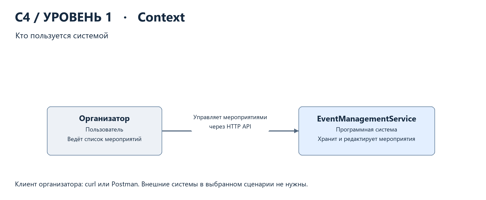
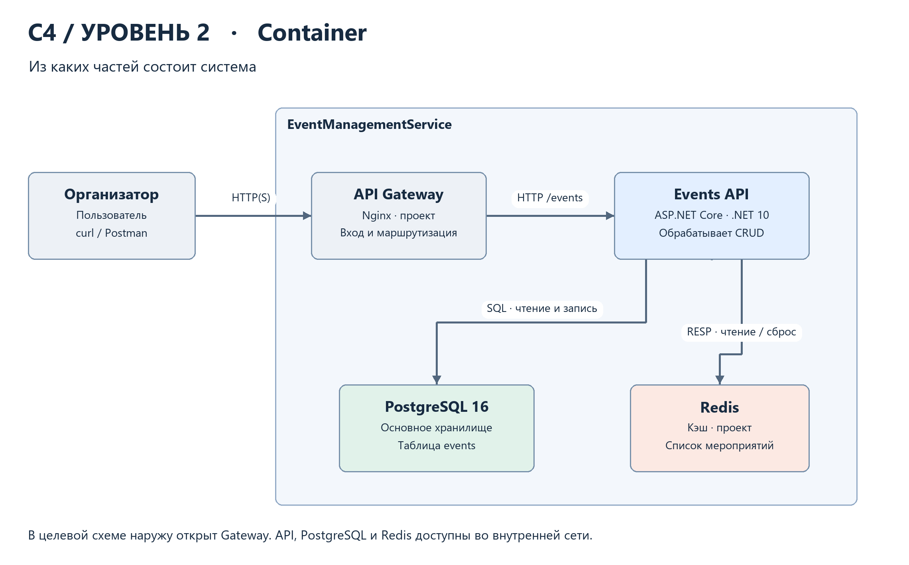
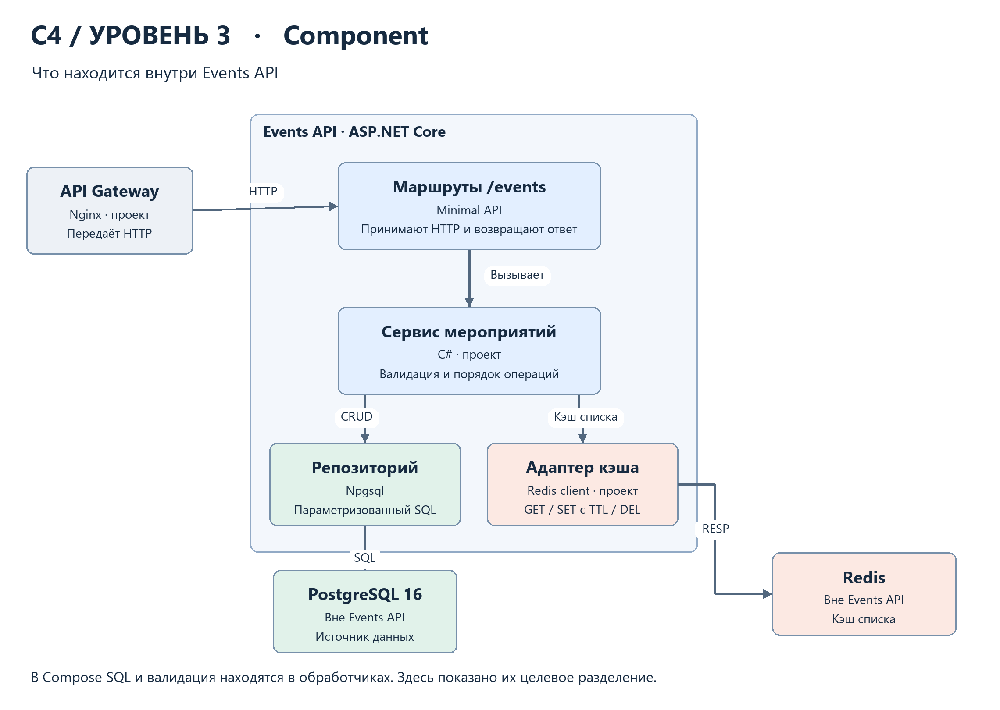

# КТ «Архитектура» — EventManagementService

Дисциплина: «Введение в DevSecOps». Тема продолжает КТ «Compose».

EventManagementService помогает организатору вести список мероприятий. Для каждого мероприятия хранятся название, дата, место и описание. Основной сценарий: организатор создаёт мероприятие, открывает список и при необходимости меняет данные или удаляет запись.

## C4 Level 1 — Context

Организатор обращается к системе через HTTP API, например из Postman или curl. Для этого сценария внешние системы не нужны.

## C4 Level 2 — Container

| Часть | Роль |
|---|---|
| API Gateway (Nginx) | Единая точка входа. Направляет запросы к /events в Events API. |
| Events API (.NET 10) | Принимает запросы CRUD и возвращает JSON. |
| PostgreSQL 16 | Основное хранилище. Хранит таблицу events и принимает все изменения. |
| Redis | Временно хранит результат GET /events, чтобы при повторном чтении не обращаться к базе. |

Для одного экземпляра API отдельный балансировщик не нужен. Gateway нужен для HTTP-маршрутизации и позволяет оставить API и хранилища во внутренней сети.

## C4 Level 3 — Component

В целевой схеме маршруты Minimal API принимают запросы и передают их сервису мероприятий. Сервис проверяет данные и управляет порядком операций. Репозиторий выполняет параметризованные запросы к PostgreSQL через Npgsql. Адаптер кэша читает, записывает и удаляет значение в Redis.

## Как работает кэш

1. При GET /events сервис читает ключ списка в Redis. Если значение есть, возвращает его.
2. Если ключа нет, сервис читает список из PostgreSQL и записывает его в Redis с TTL 30 секунд. При недоступности Redis список читается напрямую из PostgreSQL.
3. После успешного POST, PUT или DELETE сервис сбрасывает ключ списка. Если сброс не удался или параллельное чтение успело заново записать старый список, кэш может временно устареть до истечения TTL. GET /events/{id} читает PostgreSQL напрямую.

Redis выбран для повторяющихся чтений. Очередь не нужна: пользователь ждёт результат CRUD сразу. Redis хранит только копию списка; потеря кэша не удаляет мероприятия.

**Что уже есть:** в КТ «Compose» работали API и PostgreSQL. **Что спроектировано здесь:** Nginx, Redis и разделение обработчиков API на сервис и репозиторий. Эти изменения в код не вносились.

## Коротко для защиты

На первом уровне я показываю организатора и систему целиком. На втором — путь запроса от Gateway до API и два хранилища: PostgreSQL хранит данные, Redis ускоряет повторные запросы списка. На третьем уровне я раскрываю сам API: маршруты принимают HTTP, сервис управляет операцией, репозиторий работает с PostgreSQL, а адаптер — с Redis. На примере GET /events можно пройти весь путь от входа до ответа при наличии и отсутствии кэша.

Редактируемый исходник: [EventManagementService.drawio](EventManagementService.drawio). В diagrams.net он открывается как файл с тремя вкладками. PNG можно открыть отдельно.
